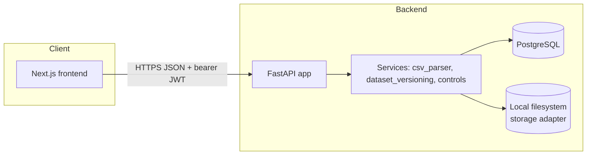

# Architecture

## Status

Covers Phases 1-5 plus pieces of Phase 6 (see each component below and
`README.md` → "Not implemented"). Observability, backup/restore drills, and pilot
gates (rest of Phase 6/7) are not built.

## Components

- **Frontend**: Next.js (App Router) + TypeScript. Talks to the backend only over the
  documented JSON API. Holds the JWT in memory/httpOnly-cookie-ready form; no business
  logic, no direct DB or storage access.
- **Backend**: FastAPI + SQLAlchemy 2.0 (sync engine) + Alembic migrations.
  Every request-handling function receives the authenticated principal
  (`user_id`, `tenant_id`) from a dependency and every query is scoped by `tenant_id`
  at the service layer — never trusted from a path/query parameter alone.
- **Database**: PostgreSQL. Money columns are `NUMERIC(18,2)`. See
  `docs/data-dictionary.md`.
- **File storage**: a small adapter interface (`app/storage/base.py`) with one
  implementation today, `LocalFilesystemStorage`, writing under a configurable,
  non-web-served directory. A production S3-compatible adapter is a drop-in
  implementation of the same interface — not built yet.
- **Background processing**: none yet. Control runs execute synchronously inside the
  request, bounded by a row-count cap (`MAX_ROWS_PER_IMPORT`) enforced before any
  parsing happens. A queue (e.g. RQ/Celery) is the documented next step once imports
  need to scale past a single request lifetime — see `DECISIONS.md`.
- **LLM**: `app/services/llm/` — a provider adapter (`AnthropicProvider`), 5 typed
  read-only tools scoped to one tenant/engagement/dataset per request, a bounded
  two-phase tool-use loop, and server-side evidence grounding. Disabled (503) unless
  `ANTHROPIC_API_KEY`/`ANTHROPIC_MODEL_ID` are configured. See
  `docs/claude-tool-contract.md` for the full contract.

## Request-time tenant isolation (how it's actually enforced)

1. `app/security.py` issues a JWT containing `sub` (user id) and `tid` (tenant id),
   signed server-side with `JWT_SECRET`.
2. `app/deps.py:get_current_principal` verifies the token and loads the
   `TenantMembership` row fresh from the DB on every request (not just trusting the
   token's claims) — a revoked membership takes effect immediately.
3. Every router function that touches `Engagement`, `SourceFile`, `ImportRun`,
   `DatasetVersion`, `TransactionRecord`, `ControlRun`, `Finding`, or
   `InvestigationRun` takes the principal's `tenant_id` and passes it into the
   corresponding service function,
   which includes `tenant_id = :tenant_id` in the `WHERE` clause of every query —
   not only in the initial lookup, but in every join. There is no "fetch by id, then
   check tenant" pattern that could be bypassed by forgetting the check — the tenant
   filter is baked into the query itself.
4. Object storage paths are namespaced `<tenant_id>/<engagement_id>/<source_file_id>`
   and the storage adapter never takes an unscoped path from a client-controlled
   value.
5. Covered by `backend/tests/test_tenant_isolation.py`.

## Data flow

Upload → validate → preview/map → commit (immutable `DatasetVersion`) → run a
control version → findings (with evidence row references) → optional Claude
investigation (read-only tools, grounded result) → reviewer disposition → report
export → audit event at every step. See `docs/data-dictionary.md` for the schema
and `docs/control-library.md` for the controls implemented so far.
